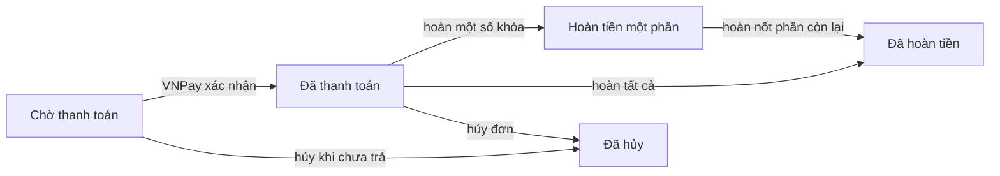

# Hướng dẫn sử dụng NhutX Learn

Cập nhật: 28/10/2026

## Giới thiệu

Tài liệu này hướng dẫn dùng trang học trực tuyến NhutX Learn cho hai nhóm người: **học viên** (Phần 1) và **quản trị viên** (Phần 2). Mỗi mục đi theo từng thao tác, theo đúng tên nút trên trang.

- **Học viên** mở trang chủ của website.
- **Quản trị viên** mở cùng trang, đăng nhập bằng tài khoản quản trị, rồi bấm **⚙️ Quản trị** trên thanh menu màu đen (hoặc thêm `#/admin` vào sau địa chỉ trang).
- Tài khoản quản trị do người cài đặt website tạo và cung cấp.

Khi gặp lỗi, xem mục **Câu hỏi thường gặp và xử lý sự cố** ở cuối tài liệu.

## Phần 1 — Học viên: tài khoản và tìm khóa học

Bạn xem và học thử không cần tài khoản; cần đăng nhập khi thanh toán, ghi danh khóa miễn phí hoặc kích hoạt mã.

**Tạo tài khoản và đăng nhập**

1. Bấm **Đăng ký / Đăng nhập** ở góc trên bên phải.
2. Chọn tab **Đăng ký**, nhập họ tên, email và mật khẩu (ít nhất 6 ký tự), bấm **Tạo tài khoản**.
3. Lần sau chọn tab **Đăng nhập**. Sau khi đăng nhập, tên của bạn hiện ở góc trên; bấm **Đăng xuất** để thoát.

Phiên đăng nhập được giữ 7 ngày. Trên máy dùng chung, hãy đăng xuất sau khi học.

**Tìm khóa học**

- **Ô tìm kiếm** ở đầu trang: gõ tên khóa học hoặc giảng viên, kết quả hiện ngay khi gõ.
- **Danh mục**: rê chuột hoặc bấm để chọn một trong 8 chủ đề.
- **Thanh menu đen**: khóa học tuyển chọn, khóa học miễn phí, khóa học về AI, gói hội viên.
- Trong trang danh sách, lọc theo **Chủ đề** và **Học phí** (miễn phí / có phí) ở cột trái; sắp xếp theo đánh giá, giá hoặc mới nhất ở góc phải.

**Xem chi tiết và học thử**

Bấm vào ảnh hoặc tên khóa học để xem mô tả, "Bạn sẽ học được gì", giáo trình và giảng viên. Trong **Nội dung khóa học**, bấm tên chương để mở danh sách bài; bài có nút **Học thử** xem được miễn phí trước khi mua.

## Mua khóa học và thanh toán VNPay

Khóa học chỉ được mở sau khi VNPay xác nhận đã trả tiền; nếu thanh toán chưa xong, giỏ hàng và đơn vẫn được giữ để bạn trả lại.

**Các bước mua**

1. Trong trang khóa học, bấm **Thêm vào giỏ hàng** (mua nhiều khóa) hoặc **Mua ngay** (đi thẳng tới giỏ). Trên thẻ khóa học ở trang chủ, rê chuột lên ảnh để thấy nút **+ Giỏ hàng**.
2. Mở giỏ hàng bằng biểu tượng 🛒 ở góc trên. Bấm **Xóa** để bỏ khóa không mua.
3. Có mã giảm giá: nhập vào ô **Mã giảm giá**, bấm **Áp dụng**. Số tiền giảm hiện ngay trong phần tổng.
4. Bấm **Thanh toán qua VNPay**. Chưa đăng nhập thì nút này là **Đăng nhập để thanh toán**; đăng nhập xong bạn được đưa về lại giỏ.
5. Trên trang VNPay, chọn cách trả (thẻ ATM nội địa, Visa/Master, quét mã QR) và làm theo hướng dẫn của ngân hàng. Giao dịch có hiệu lực trong 15 phút.
6. Xong, bạn được đưa về trang kết quả. Thành công thì khóa học vào ngay **Khóa học của tôi** và giỏ hàng được xóa các khóa đã mua.

**Khi thanh toán chưa thành công**

Trang kết quả ghi lý do (ví dụ "Tài khoản không đủ số dư", "Khách hàng đã hủy giao dịch") và có hai nút:

- **Thanh toán lại**: mở lại VNPay cho cùng đơn, không cần chọn lại khóa học.
- **Hủy đơn**: bỏ đơn này; bạn không bị trừ tiền.

Bạn cũng làm được hai việc này sau, trong **Khóa học của tôi → Lịch sử đơn hàng**: đơn chưa trả hiện nhãn **Chờ thanh toán**.

**Khóa học miễn phí**

Trong trang khóa học miễn phí, bấm **Ghi danh miễn phí** — không qua VNPay. Nếu giỏ chỉ có khóa 0đ, nút thanh toán đổi thành **Nhận khóa học miễn phí**.

## Khóa học của tôi, kích hoạt mã và hoàn tiền

Mọi khóa học bạn sở hữu và mọi đơn hàng đều nằm trong trang **Khóa học của tôi** — bấm vào tên của bạn ở góc trên để mở.

**Học bài**

Bấm **Vào học** ở khóa muốn học. Trong trang khóa học, mọi bài đều có nút **Học**; khóa bạn sở hữu được học trọn đời.

**Lịch sử đơn hàng**

Phần cuối trang liệt kê từng đơn với trạng thái, số tiền, mã giao dịch VNPay và các khóa đã được hoàn.

| Trạng thái | Ý nghĩa |
| --- | --- |
| Chờ thanh toán | Đơn đã tạo, chưa trả tiền. Có nút **Thanh toán** và **Hủy đơn**. |
| Đã thanh toán | Đã trả tiền, khóa học đã mở. |
| Hoàn tiền một phần | Một số khóa trong đơn đã được hoàn tiền và bị thu hồi. |
| Đã hoàn tiền | Toàn bộ đơn đã được hoàn. |
| Đã hủy | Đơn bị hủy; nếu đã trả tiền thì đã được hoàn. |

**Kích hoạt khóa học bằng mã**

1. Đăng nhập, bấm nút **🔑 Kích hoạt** ở đầu trang.
2. Nhập mã 12 ký tự in trên thẻ học hoặc trong email (có dấu cách hay gạch nối đều được), bấm **Kích hoạt**.
3. Khóa học vào ngay **Khóa học của tôi**. Mỗi mã chỉ dùng được một lần.

**Yêu cầu hoàn tiền**

Bạn được yêu cầu hoàn tiền trong vòng **365 ngày** kể từ ngày thanh toán.

1. Trong **Lịch sử đơn hàng**, bấm **Yêu cầu hoàn tiền** dưới đơn cần hoàn.
2. Ghi lý do, bấm **Gửi yêu cầu**. Đơn hiện nhãn **Chờ duyệt hoàn tiền**.
3. Quản trị viên xử lý: đồng ý thì tiền được hoàn về tài khoản / thẻ đã thanh toán qua VNPay và khóa học bị thu hồi; từ chối thì lý do hiện ngay dưới đơn.

Mỗi đơn chỉ có một yêu cầu chờ xử lý tại một thời điểm. Thời gian tiền về tài khoản tuỳ ngân hàng.

**Liên hệ**

Cần hỗ trợ khác, dùng mục **Liên hệ** ở chân trang: điền form hoặc gọi hotline ghi trên đó.

## Phần 2 — Quản trị: đăng nhập và trang Tổng quan

Trang quản trị chỉ mở với tài khoản có quyền quản trị; tài khoản học viên sẽ thấy thông báo "không có quyền".

**Vào trang quản trị**

1. Đăng nhập bằng tài khoản quản trị như một học viên.
2. Bấm **⚙️ Quản trị** trên thanh menu đen (trên máy tính có thêm liên kết cạnh tên bạn ở góc trên).
3. Menu bên trái có 7 mục: Tổng quan, Khóa học, Đơn hàng, Người dùng, Liên hệ & bản tin, Mã giảm giá, Mã kích hoạt. Trên điện thoại, menu nằm ngang phía trên, vuốt để xem hết.

**Đọc trang Tổng quan**

| Ô số liệu | Cách tính |
| --- | --- |
| Doanh thu thực | Tiền đã thu trừ tiền đã hoàn; dòng nhỏ ghi tổng đã hoàn |
| Đơn đã thanh toán | Không tính đơn chờ thanh toán và đơn bị hủy; dòng nhỏ ghi số đơn đang chờ |
| Chờ duyệt hoàn tiền | Số yêu cầu hoàn tiền chưa xử lý; ô chuyển đỏ khi có yêu cầu mới, bấm để mở Đơn hàng |
| Người dùng | Tổng số tài khoản |
| Lượt ghi danh | Số lượt học viên đang sở hữu khóa học |
| Khóa học | Tổng số khóa; dòng nhỏ ghi số khóa đang ẩn |
| Liên hệ mới | Form liên hệ chưa xử lý; bấm để mở |

Bên dưới là biểu đồ doanh thu thực 14 ngày gần nhất (rê chuột lên cột để xem số tiền và số đơn từng ngày), bảng 5 khóa bán chạy và 5 đơn thanh toán gần nhất. Doanh thu được tính theo ngày khách thanh toán, không phải ngày tạo đơn.

## Quản lý khóa học

Khóa học đã có học viên hoặc đơn hàng thì không xóa được, chỉ **ẩn** được — để giữ lịch sử mua hàng và quyền học của người đã mua.

**Danh sách khóa học** (mục **Khóa học**)

- Ô tìm kiếm lọc theo tên khóa học hoặc giảng viên.
- Cột **Trạng thái**: bấm **● Hiển thị** / **○ Đang ẩn** để đổi ngay. Khóa đang ẩn biến mất khỏi trang công khai và không mua được, nhưng người đã mua vẫn học được.
- **Sửa** mở form chỉnh sửa, **Xem** mở trang khóa học như học viên thấy, **Xóa** xóa vĩnh viễn (chỉ với khóa chưa ai mua).
- Cột **Đã bán** không tính khóa đã hoàn tiền; cột **Học viên** là số người đang sở hữu.

**Thêm hoặc sửa khóa học**

1. Bấm **+ Thêm khóa học** (hoặc **Sửa** ở khóa có sẵn).
2. **Thông tin chung**: tên khóa học và giảng viên là bắt buộc; thêm mô tả, trình độ, giới thiệu giảng viên.
3. **Bạn sẽ học được gì**: mỗi dòng một kết quả; **+ Thêm dòng** để thêm, ✕ để xóa.
4. **Giá**: giá bán 0đ = khóa miễn phí. Giá gốc phải lớn hơn hoặc bằng giá bán; trang hiện % giảm từ hai giá này.
5. **Phân loại**: chủ đề, nhóm trên trang chủ (Ưu đãi nhiều / Được học nhiều / Mới xuất bản / Không), tổng thời lượng.
6. **Ảnh đại diện**: chọn biểu tượng và màu nền; ô xem trước hiện ngay bên dưới.
7. **Xuất bản**: bỏ chọn **Hiển thị trên trang web** nếu muốn soạn xong rồi mới công bố. Bấm **Tạo khóa học** / **Lưu thay đổi**; thấy **✓ Đã lưu** là xong.

**Soạn giáo trình**

- Mỗi chương có tên và danh sách bài; **+ Thêm chương** ở cuối, **+ Thêm bài học** trong từng chương.
- Mỗi bài: tên, thời lượng dạng `phút:giây` (ví dụ `12:30`), và ô **Học thử** — bài được đánh dấu sẽ xem được miễn phí trước khi mua.
- Bài hoặc chương để trống tên sẽ bị bỏ qua khi lưu.
- Thứ tự hiển thị trên trang là thứ tự trong form.

## Đơn hàng, hoàn tiền và hủy đơn

Hoàn tiền và hủy đơn đều bắt buộc nhập lý do và được ghi vào lịch sử đơn. Với đơn trả qua VNPay, tiền được hoàn thật qua VNPay trước, rồi khóa học mới bị thu hồi.

Một đơn đã hủy khi chưa trả vẫn tự chuyển sang **Đã thanh toán** nếu tiền của khách về sau đó. **Đã hoàn tiền** và **Đã hủy** là trạng thái cuối, không còn thao tác nào.

**Tìm đơn**

- Các tab phía trên lọc theo trạng thái; tab **Chờ duyệt hoàn tiền** gom các đơn khách đang xin hoàn. Những đơn này luôn nằm đầu danh sách.
- Ô tìm kiếm nhận mã đơn, tên, email hoặc tên khóa học.
- Bấm số đơn hoặc **Chi tiết** để mở trang xử lý.

**Trang chi tiết đơn**

- **Khóa học trong đơn**: cột **Khách trả** là số tiền thực của từng khóa, đã chia mã giảm giá theo tỷ lệ giá. Đây là số tiền sẽ hoàn nếu chọn khóa đó.
- **Thanh toán**: phương thức, thời điểm, mã giao dịch VNPay, ngân hàng, mã tham chiếu và từng lượt thanh toán (thành công / thất bại kèm lý do).
- **Lịch sử**: mọi bước từ lúc tạo đơn, ai làm, lúc nào, bao nhiêu tiền.

**Hoàn tiền từng khóa**

1. Tick các khóa cần hoàn (hoặc **Chọn tất cả khóa chưa hoàn**).
2. Nhập **Lý do** — khách sẽ thấy lý do này.
3. Bấm nút **Hoàn tiền …đ (n khóa)**, kiểm tra số tiền trong hộp xác nhận rồi đồng ý.
4. Thấy **✓ Đã hoàn …đ** là xong: khóa chuyển sang **Đã hoàn** và khách mất quyền học khóa đó.

Nếu VNPay từ chối, trang báo lý do và **không có gì thay đổi** (xem mục xử lý sự cố).

**Hủy đơn**

- **Đơn đã thanh toán, chưa hoàn phần nào**: nút **Hủy đơn hàng** hoàn toàn bộ tiền và thu hồi mọi khóa. Dùng khi thanh toán lỗi hoặc đơn gian lận; còn khách đổi ý thì dùng hoàn tiền.
- **Đơn chờ thanh toán**: nút **Hủy đơn chưa thanh toán**, không có tiền để hoàn, ghi chú không bắt buộc.

**Duyệt yêu cầu hoàn tiền của khách**

Khung vàng ở đầu trang chi tiết hiện lý do khách gửi.

- **Đồng ý**: chọn khóa và hoàn tiền như trên; yêu cầu tự đóng.
- **Từ chối**: nhập lý do, bấm **Từ chối yêu cầu**. Khách thấy lý do trong lịch sử đơn và có thể gửi lại yêu cầu mới.

## Người dùng, liên hệ, mã giảm giá và mã kích hoạt

Bốn mục này dùng hằng ngày: cấp quyền, trả lời khách, chạy khuyến mãi và phát mã học.

**Người dùng**

- Danh sách hiện số khóa học và số tiền thực đã chi (đã trừ hoàn tiền) của từng người; tìm theo tên hoặc email.
- **Cấp quyền QT** biến một học viên thành quản trị viên; **Bỏ quyền** làm ngược lại. Có hiệu lực ngay.
- Bạn không tự bỏ quyền quản trị của chính mình được, nên luôn còn ít nhất một quản trị viên.

**Liên hệ & bản tin**

- Mỗi thẻ là một form khách gửi (Liên hệ, Doanh nghiệp, Giảng viên), kèm email, số điện thoại và lời nhắn. Bấm vào email hoặc số điện thoại để liên hệ ngay.
- Đổi trạng thái trong ô chọn: **Mới** → **Đã liên hệ** → **Hoàn tất**. Các tab phía trên lọc theo trạng thái.
- Phần **Đăng ký bản tin** liệt kê email đăng ký ở chân trang; **Sao chép danh sách email** để dán vào công cụ gửi thư.

**Mã giảm giá**

1. Nhập mã mới (chỉ chữ và số, 3–30 ký tự) và % giảm (1–100), bấm **+ Tạo mã**.
2. Đổi % giảm trực tiếp trong bảng; giá trị mới được lưu khi bạn bấm ra ngoài ô.
3. Bấm **● Đang bật** để tắt mã khi hết khuyến mãi — nên tắt thay vì xóa để giữ số lần đã dùng.

Mã giảm theo % tổng giỏ hàng và áp dụng cho mọi khóa học.

**Mã kích hoạt**

1. Chọn khóa học và số lượng (1–100), bấm **Tạo mã**.
2. Mã mới hiện trong khung xanh; **Sao chép tất cả** để in thẻ hoặc gửi email cho khách.
3. Bảng bên dưới cho biết mã nào đã dùng, bởi ai, lúc nào. Chỉ xóa được mã chưa dùng.

Mã gồm 12 ký tự, không có các ký tự dễ nhầm O/0 và I/1. Mã kích hoạt không qua thanh toán nên không tính vào doanh thu.

## Câu hỏi thường gặp và xử lý sự cố

Hầu hết sự cố thanh toán tự giải quyết khi mở lại đơn trong Lịch sử đơn hàng; trường hợp tiền đã trừ mà chưa có khóa thì quản trị viên kiểm tra theo mã giao dịch.

**Dành cho học viên**

| Tình huống | Cách xử lý |
| --- | --- |
| Đã bị trừ tiền nhưng chưa thấy khóa học | Tải lại trang **Khóa học của tôi** sau vài phút. Nếu đơn vẫn **Chờ thanh toán**, gửi form **Liên hệ** kèm số đơn và mã giao dịch trong tin nhắn ngân hàng. |
| Trang kết quả báo "Không xác thực được kết quả thanh toán" | Dữ liệu từ cổng thanh toán không hợp lệ. Nếu đã bị trừ tiền, liên hệ hỗ trợ như trên. |
| Lỡ trả tiền hai lần cho cùng đơn | Hệ thống ghi nhận và báo cho quản trị viên; liên hệ hỗ trợ để được hoàn lần thừa. |
| Đã hủy đơn nhưng tiền vẫn bị trừ | Đơn tự chuyển về **Đã thanh toán** và khóa học được mở; muốn lấy lại tiền thì gửi **Yêu cầu hoàn tiền**. |
| Mã giảm giá báo không hợp lệ | Kiểm tra chính tả; mã có thể đã hết hạn khuyến mãi. |
| Mã kích hoạt báo "đã được sử dụng" | Mỗi mã dùng một lần; kiểm tra **Khóa học của tôi** xem khóa đã có chưa, nếu chưa thì liên hệ nơi phát mã. |
| Báo "Bạn thao tác quá nhiều lần" | Hệ thống tạm khóa sau nhiều lần thử sai (ví dụ 10 lần đăng nhập sai trong 15 phút). Chờ đúng thời gian ghi trong thông báo rồi thử lại. |
| Không thấy nút Yêu cầu hoàn tiền | Đơn đã quá 365 ngày, đang có yêu cầu chờ xử lý, hoặc đã hoàn / hủy. |

**Dành cho quản trị viên**

| Tình huống | Cách xử lý |
| --- | --- |
| Khách báo đã trả tiền mà đơn vẫn Chờ thanh toán | Mở đơn, xem **lượt thanh toán** trong khung Thanh toán. Tra mã tham chiếu trên cổng quản lý merchant của VNPay; nếu VNPay báo thành công, báo bộ phận kỹ thuật vì thông báo IPN không đến được server. |
| Lịch sử đơn có dòng **⚠️ Khách thanh toán trùng** | Hoàn giao dịch bị trùng (mã ghi trong dòng đó) trực tiếp trên cổng quản lý của VNPay — trang quản trị chỉ hoàn giao dịch chính của đơn. |
| Báo "VNPay chưa hoàn tiền: …" | Chưa có gì thay đổi: khách vẫn giữ khóa học. Đọc lý do VNPay trả về, thử lại sau; nếu lặp lại, kiểm tra giao dịch trên cổng quản lý VNPay trước khi thử nữa để tránh hoàn hai lần. |
| Báo "Đơn hàng đang được xử lý" | Một quản trị viên khác đang hoàn tiền đơn này; tải lại trang sau vài giây. |
| Không xóa được khóa học | Khóa đã có đơn, học viên hoặc mã kích hoạt; dùng **Đang ẩn** thay vì xóa. |
| Khách báo "Cổng thanh toán chưa được cấu hình" | Server chưa có thông tin VNPay; báo người cài đặt (hướng dẫn trong tài liệu kỹ thuật [README.md](README.md)). |
